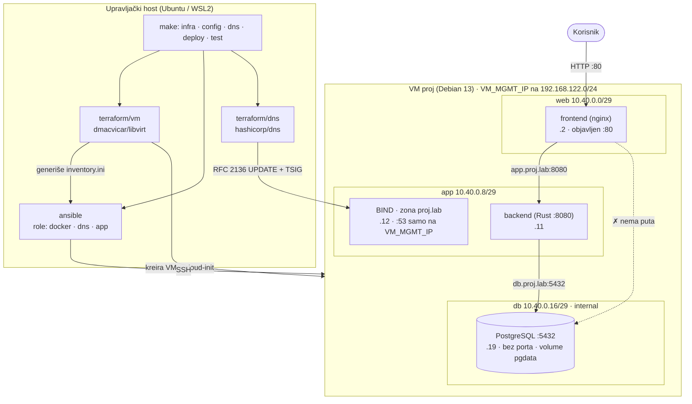

# Troslojna aplikacija kao kod

Projektni zadatak iz predmeta **Računarstvo u oblaku** (II ciklus, 2026/27).

Infrastruktura za troslojnu web aplikaciju `biljeske` je u potpunosti opisana kodom:

- virtuelna mašina (Terraform + libvirt)
- početna konfiguracija (cloud-init)
- konfiguracija servera (Ansible role)
- kontejneri (Docker Compose)
- tri izolovana mrežna segmenta i autoritativni DNS (BIND), čije zapise vodi Terraform.

Dizajnerske odluke (DO-1 do DO-9) i ADR-ovi su u PDF dokumentu predaje. Ovdje je samo sažetak u [tabeli odluka](#dizajnerske-odluke-sažetak).

## Pokretanje od nule

Kratko: `./setup.sh` (jednom) → `make check` → `make all` → `make destroy`. Detaljni koraci su ispod.

### 0. Preduvjeti

- Ubuntu/Debian ili Windows sa WSL2 (Ubuntu), virtualizacija uključena u BIOS-u/UEFI-ju.
- Najmanje 4 GiB slobodnog RAM-a (VM dobija 2 GiB) i nekoliko GiB diska (disk VM-a je copy-on-write, raste do najviše 20 GiB).
- Pristup internetu: Debian cloud slika, Docker slike i Rust crate-ovi se skidaju pri prvom podizanju.

**Samo za WSL2:** VM traži ugniježđenu virtualizaciju. U Windowsu napravite ili dopunite `%UserProfile%\.wslconfig`:

```ini
[wsl2]
nestedVirtualization=true
```

zatim u PowerShellu pokrenite `wsl --shutdown` i ponovo otvorite Ubuntu. Provjera: `ls -l /dev/kvm` mora pokazati uređaj.

### 1. Alati (jednom po računaru)

```bash
git clone https://github.com/SafetImamovic/RuO-Projekat projekat && cd projekat
./setup.sh
```

`setup.sh` (ne pokreće se kao root; sam traži `sudo`) instalira `make`, Ansible, `dig`/`nsupdate`, QEMU/KVM, libvirt, Docker i Terraform. Uz to podiže libvirt pool i mrežu `default`, pravi SSH ključ `~/.ssh/id_ed25519` (ako ga nema) i dodaje korisnika u grupe `libvirt` i `docker`. Skripta je idempotentna, pa je sigurno pokrenuti je ponovo.

Grupe počnu važiti tek nakon nove prijave: odjavite se i prijavite ponovo (na WSL2 `wsl --shutdown` u PowerShellu). Zatim:

```bash
groups                # mora sadržavati libvirt i docker
make check            # svi alati i /dev/kvm moraju biti [ OK ]
```

### 2. Podizanje

```bash
make all              # infra → config → dns → deploy → test
```

| Korak | Šta se dešava |
|---|---|
| `infra` | Terraform skida Debian sliku, pravi disk, cloud-init ISO i VM, i piše `inventory.ini` |
| `config` | Ansible čeka SSH i cloud-init, instalira Docker, generiše tajne u `.secrets/` (samo prvi put) i podiže BIND |
| `dns` | Terraform upisuje `web`, `app`, `db` i `www` u zonu `proj.lab` |
| `deploy` | Ansible prenosi kod, gradi slike (prvi put kompajlira Rust, nekoliko minuta) i čeka healthcheck svih servisa |
| `test` | svi testovi moraju biti `[ OK ]` |

Prvo podizanje je najsporije zbog skidanja slika i kompajliranja Rusta. Svaki korak ispisuje živi prozor napretka, a puni izlaz ide u `.logs/`. `V=1 make all` ispisuje cijeli izlaz direktno.

### 3. Korištenje

```bash
terraform -chdir=terraform/vm output -raw ip   # adresa VM-a
make tunnel                                    # http://localhost:8080, ili prvi slobodan port (ispiše ga)
make ps                                        # kontejneri na VM-i
make ssh                                       # prijava na VM, samo ključem
```

### 4. Uklanjanje

```bash
make destroy
```

Terraform uklanja VM, njen disk, baznu Debian sliku, cloud-init ISO i `inventory.ini`. Zajedno s VM-om nestaju i svi kontejneri, volumen baze i DNS zona. Makefile zatim briše lokalni state `terraform/dns`, jer zapisi više ne postoje.

Provjera da ništa nije ostalo:

```bash
virsh -c qemu:///system list --all          # nema domene "proj"
virsh -c qemu:///system vol-list default    # nema proj.qcow2, proj-init.iso ni debian-13-genericcloud.qcow2
```

Šta namjerno ostaje:

| Ostaje | Zašto | Potpuno brisanje |
|---|---|---|
| `.secrets/` | tajne se ponovo koriste pri sljedećem `make all` | `rm -rf .secrets` (**samo nakon** `make destroy`, inače baza ostaje sa starom lozinkom) |
| `terraform/*/.terraform/` | keš providera, ubrzava `init` | `rm -rf terraform/*/.terraform` |
| `.logs/`, `backups/` | logovi i backupi baze | `rm -rf .logs backups` |
| alati iz `setup.sh`, SSH ključ | dijele se s drugim projektima | ručno, ako je potrebno |

Sve osim alata i backupa uklanja jedna naredba, nakon koje je repozitorij kao svjež klon:

```bash
make destroy clean
```

`make clean` sam po sebi odbija raditi dok Terraform još vodi VM. Brisanje state-a bi ostavilo VM bez upravljanja, a brisanje `.secrets/` bazu sa lozinkom koju više niko nema.

### 5. Tok odbrane

```bash
make destroy          # prazan sistem
make all              # od nule do aplikacije koja radi, s testovima
make test             # ponovo, samostalno
make all              # drugo izvršavanje: Terraform "No changes", Ansible changed=0
make drift            # izmjena DNS zapisa mimo koda, plan je vidi, apply je vraća
```

### Česti problemi

| Simptom | Uzrok i rješenje |
|---|---|
| `make check`: `/dev/kvm` FAIL | nije uključena (ugniježđena) virtualizacija; vidi korak 0 |
| `permission denied` na libvirt ili Docker socketu | grupe još ne važe; nova prijava ili `wsl --shutdown` |
| `make dns` ne može doći do servera | BIND ne radi jer `make config` nije prošao; pokrenite ga prvo |
| `make deploy` istekne čekajući healthcheck | `make ps` i `.logs/` pokazuju koji servis nije zdrav |

| Cilj                                       | Šta radi                                                                             |
| ------------------------------------------ | ------------------------------------------------------------------------------------ |
| `make check`                               | provjera alata i `/dev/kvm`                                                          |
| `make infra`                               | Terraform: bazna slika, disk, cloud-init ISO, VM, `inventory.ini`                    |
| `make config`                              | Ansible (tag `config`): Docker, `compose.yaml`, `.env`, BIND                         |
| `make dns`                                 | Terraform: A i CNAME zapisi kroz RFC 2136 + TSIG                                     |
| `make deploy`                              | Ansible (tag `deploy`): rsync koda, build slika, pokretanje i čekanje healthcheckova |
| `make test`                                | svi testovi (`tests/test.sh`)                                                        |
| `make drift`                               | demonstracija drifta DNS zapisa (`tests/drift.sh`)                                   |
| `make all`                                 | `infra config dns deploy test`                                                       |
| `make destroy`                             | uklanjanje svega što je projekat kreirao                                             |
| `make clean`                               | repozitorij kao svjež klon: briše sve ignorisano (osim `.notes/`, `backups/`); odbija dok VM postoji |
| `make ps`, `make endpoints`, `make tunnel` | pomoćni: kontejneri, nginx rute, SSH tunel na `localhost:8080` ili prvi slobodan port |

Bez Makefilea su to iste naredbe, ovim redom:

```bash
terraform -chdir=terraform/vm init && terraform -chdir=terraform/vm apply
(cd ansible && ansible-playbook site.yml --tags config)
export TF_VAR_dns_server=$(terraform -chdir=terraform/vm output -raw ip) TF_VAR_tsig_secret=$(cat .secrets/tsig_secret)
terraform -chdir=terraform/dns init && terraform -chdir=terraform/dns apply
(cd ansible && ansible-playbook site.yml --tags deploy)
VM_IP=$TF_VAR_dns_server bash tests/test.sh
```

Redoslijed je bitan: BIND mora raditi (`config`) prije nego što Terraform upiše zapise (`dns`), a zapisi moraju postojati prije aplikacije (`deploy`), jer nginx pri pokretanju razrješava `app.proj.lab`.

Aplikacija je dostupna na `http://<VM_IP>/` (`terraform -chdir=terraform/vm output -raw ip`). Iz Windows preglednika pokrenite `make tunnel` i otvorite adresu koju ispiše (`http://localhost:8080`, ili sljedeći slobodan port ako je 8080 zauzet; tačan port: `make tunnel PORT=9000`).

### Izmjena kroz kod (primjeri)

- **Parametar VM-a:** promijenite `default` varijable (npr. `memory`) u `terraform/vm/main.tf` i pokrenite `make infra`. Jednokratni `-var` na komandnoj liniji bi sljedeći `make infra` vratio na staro.
- **Novi DNS zapis:** dodajte resurs u `terraform/dns/main.tf` (npr. još jedan `dns_cname_record`) i pokrenite `make dns`.
- **Adresa kontejnera:** promijenite je samo u `app/compose.yaml`, pa pokrenite `make config dns deploy`.
- **Druga instanca na istom hostu** (npr. drugi klon): imena u libvirtu (VM, diskovi, ISO, bazna slika) se izvode iz `vm_name`, pa u drugom klonu prije `make all` postavite drugo ime: `echo 'vm_name = "proj2"' > terraform/vm/terraform.tfvars`.

---

## Aplikacija

| Sloj     | Tehnologija                                             | Uloga                                                                     |
| -------- | ------------------------------------------------------- | ------------------------------------------------------------------------- |
| frontend | nginx (`nginx:alpine`)                                  | statični `index.html`; `/api/*` prosljeđuje na `http://app.proj.lab:8080` |
| backend  | Rust (`tiny_http` + `postgres`), multi-stage Dockerfile | `GET /health`, `GET /notes`, `POST /notes`                                |
| baza     | PostgreSQL 16 (`postgres:16-alpine`) + volume `pgdata`  | tabela `notes`                                                            |
| DNS      | BIND 9.20 (`internetsystemsconsortium/bind9`)           | autoritativna zona `proj.lab`                                             |

Tok zahtjeva je isključivo `frontend → backend → baza` (AO-1).

## Arhitektura (stvarni raspored)

Jedna VM (Debian 13, KVM) na libvirt mreži `default`. Segmenti su Docker mreže s fiksnim podmrežama, a svaki kontejner je samo na mrežama koje mu trebaju (DO-2, opcija A).



## Plan adresiranja i izolacija (AO-6, DO-3)

Plan adresiranja ima **jedan izvor**: [`app/compose.yaml`](app/compose.yaml). Terraform (`terraform/dns`, kroz `yamldecode`) i Ansible (rola `dns`, kroz `from_yaml`) adrese čitaju odatle, pa nigdje nema druge kopije.

| Segment     | Podmreža                                   | Gateway    | Kontejneri                          | Napomena                               |
| ----------- | ------------------------------------------ | ---------- | ----------------------------------- | -------------------------------------- |
| web         | 10.40.0.0/29                               | 10.40.0.1  | frontend .2                         | jedini objavljen port aplikacije: 80   |
| app         | 10.40.0.8/29                               | 10.40.0.9  | frontend .10, backend .11, BIND .12 |                                        |
| db          | 10.40.0.16/29                              | 10.40.0.17 | backend .18, PostgreSQL .19         | `internal: true`, nema izlaza ni porta |
| upravljanje | 192.168.122.0/24 (libvirt `default`, DHCP) |            | VM                                  | SSH :22, HTTP :80, DNS :53             |

| Kontejner  | web | app | db  | Objavljen port                   |
| ---------- | :-: | :-: | :-: | -------------------------------- |
| frontend   | OK  | OK  |     | 80                               |
| backend    |     | OK  | OK  |                                  |
| BIND       |     | OK  |     | 53/udp+tcp, samo na `VM_MGMT_IP` |
| PostgreSQL |     |     | OK  |                                  |

**Kako je izolacija postignuta:**

- Frontend **nije priključen** na mrežu `db`, pa nema ni interfejs ni rutu prema bazi. Promet između Docker bridge mreža Docker blokira svojim iptables pravilima.
- Mreža `db` je `internal: true`: nema gateway prema vani, pa baza ne može izaći niti biti objavljena.
- Baza nema objavljen port. Izvana je dostupan samo port 80 (frontend).
- Port 53 je upravljački kanal, a ne sloj aplikacije. Terraform s hosta preko njega šalje RFC 2136 update potpisan TSIG ključem. BIND je čisto autoritativan (`recursion no`), pa nije otvoren resolver.

## DNS (AO-7, AO-8, DO-8)

Zona `proj.lab`, TTL 300, jedan primarni BIND, dinamička zona. Komponente se međusobno adresiraju samo imenima: nginx koristi `app.proj.lab`, a backend `db.proj.lab`.

| Ime            | Tip   | Vrijednost      | Upravlja                           |
| -------------- | ----- | --------------- | ---------------------------------- |
| `ns1.proj.lab` | A     | 10.40.0.12      | početna zona (Ansible, glue za NS) |
| `web.proj.lab` | A     | 10.40.0.2       | Terraform                          |
| `app.proj.lab` | A     | 10.40.0.11      | Terraform                          |
| `db.proj.lab`  | A     | 10.40.0.19      | Terraform                          |
| `www.proj.lab` | CNAME | `web.proj.lab.` | Terraform                          |

TSIG ključ `tsig-proj` (hmac-sha256) ima politiku `update-policy { grant tsig-proj zonesub A CNAME; }`. Smije mijenjati samo imena unutar zone `proj.lab` i samo tipove A i CNAME, a SOA i NS ne smije dirati.

IP adrese se u kodu pojavljuju samo na mjestima gdje se **definišu**: plan adresiranja u `compose.yaml` i adresa resolvera (`dns:`), koja mora biti IP jer se resolver ne može razriješiti imenom. Kod koji komponente koriste da se obrate jedna drugoj (`nginx.conf`, `index.html`, `backend/src`) ne sadrži IP adrese, što provjerava `make test`.

## Tajne (AO-9, DO-9)

Tajne se **generišu pri prvom pokretanju** (Ansible `lookup('password', …)`) i spremaju u `.secrets/` na hostu. Taj direktorij je u `.gitignore`.

| Tajna        | Fajl                   | Koristi                                                            |
| ------------ | ---------------------- | ------------------------------------------------------------------ |
| lozinka baze | `.secrets/db_password` | `.env` na VM-u (mode 0600) → PostgreSQL i backend                  |
| TSIG ključ   | `.secrets/tsig_secret` | `keys.conf` u BIND-u i `terraform/dns` (kroz `TF_VAR_tsig_secret`) |
| SSH ključ    | `~/.ssh/id_ed25519`    | van repozitorija; javni ključ ide u cloud-init                     |

U Gitu nema `*.tfstate`, `.terraform/`, `.env`, `inventory.ini` ni `.secrets/`. `make test` provjerava da `.secrets/` nikad nije ušao u historiju.

> `.secrets/` je stanje, isto kao tfstate. Ako se `db_password` obriše dok VM postoji, generiše se nova lozinka, ali PostgreSQL zadržava staru (`POSTGRES_PASSWORD` se čita samo pri inicijalizaciji praznog volumena), pa se backend ne može spojiti. Tada pokrenite `make destroy && make all`.

---

## Dokazi

### Terraform: `plan` nakon `apply` (AO-3)

```
$ terraform -chdir=terraform/vm plan
No changes. Your infrastructure matches the configuration.

Terraform has compared your real infrastructure against your configuration
and found no differences, so no changes are needed.
```

### Drift DNS zapisa (AO-8, `make drift`)

Zapis `db.proj.lab` se izmijeni **mimo koda** (`nsupdate` s istim TSIG ključem) na `10.40.0.99`. `terraform plan` primijeti razliku, a `terraform apply` vrati stanje iz koda:

```
== izmjena db.proj.lab mimo koda (nsupdate)
10.40.0.99
== plan pokazuje drift
dns_a_record_set.servis["db"]: Refreshing state... [id=db.proj.lab.]

Terraform will perform the following actions:

  # dns_a_record_set.servis["db"] will be updated in-place
  ~ resource "dns_a_record_set" "servis" {
      ~ addresses = [
          - "10.40.0.99",
          + "10.40.0.19",
        ]
        id        = "db.proj.lab."
        name      = "db"
        # (2 unchanged attributes hidden)
    }

Plan: 0 to add, 1 to change, 0 to destroy.
== apply vraća stanje
dns_a_record_set.servis["db"]: Modifying... [id=db.proj.lab.]
dns_a_record_set.servis["db"]: Modifications complete after 0s [id=db.proj.lab.]

Apply complete! Resources: 0 added, 1 changed, 0 destroyed.
10.40.0.19
```

### Idempotentnost: drugo izvršavanje playbooka (AO-5)

Slike se ponovo grade samo kad `synchronize` prenese novi kod (`build: always`). Inače se koristi `build: policy`, pa drugo izvršavanje ništa ne mijenja:

```
$ cd ansible && ansible-playbook site.yml
TASK [čekaj da SSH postane dostupan] ******************************************* ok: [proj]
TASK [čekaj da cloud-init završi] ********************************************** ok: [proj]
TASK [prikupi činjenice] ******************************************************* ok: [proj]
TASK [docker : Docker Engine, Compose i Python biblioteka za Ansible module] *** ok: [proj]
TASK [docker : Docker radi] **************************************************** ok: [proj]
TASK [docker : direktorij projekta] ******************************************** ok: [proj]
TASK [docker : compose.yaml] *************************************************** ok: [proj]
TASK [docker : .env (tajne, samo root čita)] *********************************** ok: [proj]
TASK [dns : direktorij BIND-a (bind čita i piše zonu i žurnal)] **************** ok: [proj]
TASK [dns : named.conf] ******************************************************** ok: [proj]
TASK [dns : keys.conf (TSIG ključ)] ******************************************** ok: [proj]
TASK [dns : početna zona (samo ako ne postoji)] ******************************** ok: [proj]
TASK [dns : BIND radi i zdrav je] ********************************************** ok: [proj]
TASK [app : izvorni kod frontenda i backenda] ********************************** ok: [proj] (frontend, backend)
TASK [app : aplikacija je izgrađena i radi (čeka healthcheck svih servisa)] **** ok: [proj]

PLAY RECAP *********************************************************************
proj                       : ok=15   changed=0    unreachable=0    failed=0    skipped=0    rescued=0    ignored=0
```

### Testovi (`make test`)

Svaki negativni test izolacije ima pozitivnu kontrolu istim alatom s istog mjesta. Tako pad negativnog testa znači mrežnu izolaciju, a ne nedostatak alata ili DNS zapisa.

```
== aplikacija (frontend -> backend -> baza)
  [ OK ] GET /api/notes kroz nginx
  [ OK ] POST /api/notes
  [ OK ] bilješka se čita nazad
== izolacija (AO-6)
  [ OK ] kontrola: frontend -> app:8080 radi
  [ OK ] frontend -> db:5432 mora pasti
  [ OK ] frontend -> db:5432 po IP-u pada
  [ OK ] backend -> db:5432 radi
  [ OK ] kontrola: host -> VM:80 radi
  [ OK ] 5432 nije dostupan izvana
== DNS (AO-7): dig odgovara docker inspect
  [ OK ] web.proj.lab = 10.40.0.2
  [ OK ] app.proj.lab = 10.40.0.11
  [ OK ] db.proj.lab = 10.40.0.19
  [ OK ] www CNAME -> web
== nema IP adresa u kodu aplikacije (AO-7; 0.0.0.0 je bind na sve interfejse, ne adresa)
  [ OK ] bez IP adresa
== tajne nisu u Gitu (AO-9)
  [ OK ] .secrets u historiji
== trajnost podataka (AO-10)
  [ OK ] bilješka preživjela ponovno kreiranje baze
```

---

## Dizajnerske odluke (sažetak)

Puni ADR-ovi su u PDF dokumentu predaje.

| DO   | Odluka                                                                                                                                    |
| ---- | ----------------------------------------------------------------------------------------------------------------------------------------- |
| DO-1 | Vlastita aplikacija „bilješke“: nginx + statični HTML, Rust (`tiny_http`, `postgres`), PostgreSQL 16                                      |
| DO-2 | Opcija A: jedna VM, segmenti kao Docker mreže s fiksnim podmrežama; BIND na istoj VM-i                                                    |
| DO-3 | Tri /29 podmreže iz 10.40.0.0/27, statične adrese kontejnera, jedini izvor je `compose.yaml`; adresa VM-a preko DHCP-a (Terraform output) |
| DO-4 | Javna Debian 13 genericcloud slika + cloud-init                                                                                           |
| DO-5 | Build na ciljnoj VM-i; multi-stage Dockerfile za Rust; ponovni build samo kad se promijeni kod                                            |
| DO-6 | `inventory.ini` generisan iz Terraformovog stanja (`local_file`)                                                                          |
| DO-7 | Role po funkciji (`docker`, `dns`, `app`); konstante u `defaults`, vrijednosti okruženja u `group_vars/all.yml`                           |
| DO-8 | Zona `proj.lab`, TTL 300, jedan primarni BIND, dinamička zona; TSIG ograničen na zonu i tipove A/CNAME; bez PTR-a i sekundarnog servera   |
| DO-9 | Tajne se generišu pri prvom pokretanju u `.secrets/` (van Gita), bez ansible-vaulta                                                       |

## Struktura repozitorija

```
app/              frontend/ (nginx), backend/ (Rust), compose.yaml (jedini izvor adresa)
terraform/vm/     VM, disk, cloud-init ISO, inventory.ini (AO-3)
terraform/dns/    DNS zapisi kroz RFC 2136 (AO-8)
cloud-init/       user-data šablon (AO-4)
ansible/          site.yml, group_vars/, role docker · dns · app (AO-5, AO-7)
tests/            test.sh (izolacija, dig, aplikacija, tajne, AO-10), drift.sh
scripts/step.sh   prikaz napretka za Makefile; puni izlaz ide u .logs/
setup.sh          instalacija alata na praznom računaru
Makefile
```

Odstupanja od preporučene strukture: `scripts/` i `setup.sh` su dodani radi ponovljivosti od praznog računara. Šablon za DNS zonu i BIND konfiguraciju je u Ansible roli `dns`, jer je postavljanje servera posao konfiguracije (AO-5), a Terraform vodi samo zapise (AO-8).
